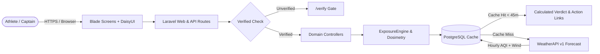

# Alveo

[](https://laravel.com)
[](https://www.php.net)
[](https://www.postgresql.org)
[](https://tailwindcss.com)
[](https://daisyui.com)
[](LICENSE)

Alveo is an aerobic clean-air window scheduler and pulmonary exposure engine built for outdoor athletes.
It helps runners, cyclists, and community fitness groups pinpoint the cleanest training windows across urban areas like Greater Jakarta where morning particulate spikes and surface inversions pose respiratory hazards.

Instead of passive historical pollution charts, Alveo translates atmospheric particulate concentrations into active pulmonary exposure calculations.
It computes minute-ventilation across athletic heart rate zones, evaluates contiguous hourly forecast blocks, delivers binary Go or Postpone recommendations, and offloads reminders via native calendar events and Telegram dispatch cards.

## Quickstart (Docker)

1. Clone the repository and enter the directory:
   ```bash
   git clone https://github.com/your-username/alveo.git
   cd alveo
   ```
2. Copy the environment file and set your WeatherAPI key:
   ```bash
   cp .env.example .env
   ```
   Add your API key to `WEATHERAPI_KEY` in `.env` (optional; the built-in deterministic model serves realistic data if left blank).
3. Start the containers using Docker Compose:
   ```bash
   docker compose up -d --build
   ```
4. Access the web services:
   - Main Application: [http://localhost:8085](http://localhost:8085)
   - Database UI (Adminer): [http://localhost:8080](http://localhost:8080) (System: PostgreSQL, Server: `db`, Username: `alveo`, Password: `alveo_secret`, Database: `alveo`)
5. Sign in using the seeded test accounts:
   - Verified Athlete: `rafif@alveo.id` / `password`
   - Pending Approval Account: `pending@alveo.id` / `password` (tests the `/verify` gate)

## Quickstart (Local Development Without Docker)

To run the application directly on your host machine without Docker:

1. Ensure prerequisites are installed: PHP 8.2 or higher (with `pdo_sqlite` or `pdo_pgsql`, `mbstring`, `intl`), Composer, and Node.js 18+.
2. Install PHP and frontend dependencies:
   ```bash
   composer install
   npm install
   npm run build
   ```
3. Configure your local `.env`:
   ```bash
   cp .env.example .env
   php artisan key:generate
   ```
   For rapid local development, switch the database driver from PostgreSQL to SQLite:
   ```env
   DB_CONNECTION=sqlite
   DB_DATABASE=/absolute/path/to/database/database.sqlite
   ```
   Create the SQLite file with `touch database/database.sqlite`.
4. Run migrations and database seeders:
   ```bash
   php artisan migrate --seed
   ```
5. Start the local server:
   ```bash
   php artisan serve
   ```
   Visit [http://localhost:8000](http://localhost:8000).

## High-Level Architecture Overview



Alveo operates as a stateless computational pipeline with on-demand database caching.
Requests pass through Laravel session authentication and the verification gate before reaching domain controllers.
Atmospheric forecasts are cached in PostgreSQL for 45 minutes per coordinate grid, eliminating redundant upstream calls and keeping the system fully within the WeatherAPI Free Tier.

## Documentation Index

Explore the detailed architecture and engineering rationale in the documentation folder:

- [Architecture Guide](docs/architecture.md): Complete technical breakdown, component directory cheatsheet, dosimetry formulas, and database schemas.
- [Architecture Decision Records](docs/decisions.md): Engineering rationales for API provider selection, caching strategy, and the verification gate.
- [WeatherAPI Documentation Map](docs/weatherapi/INDEX.md): Line-by-line index of upstream parameters, error codes, and air quality schemas.
