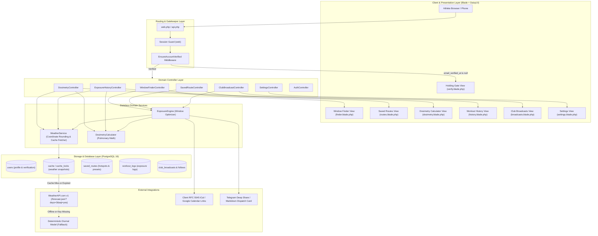

# Alveo System Architecture

This document provides a technical specification and component cheatsheet for the Alveo codebase.
It maps out all core subsystems so developers can understand and extend the system without reading through every individual implementation file.

## Detailed System Architecture



## Component Directory Cheatsheet

This cheatsheet extracts all key files in the application so you can locate domain logic quickly.

### Controllers (`app/Http/Controllers/`)
* `WindowFinderController.php`: Serves the primary operational dashboard (`GET /` and `GET /finder`). Handles coordinate queries, preset corridor lookups, `.ics` file downloads (`GET /calendar/ics`), and the REST evaluation endpoint (`POST /api/v1/evaluate-window`).
* `SavedRouteController.php`: Manages verified presets and user-saved running/cycling routes (`GET /routes`, `POST /routes`, `DELETE /routes/{route}`). Automatically enriches corridor cards with cached environmental snapshots.
* `DosimetryController.php`: Drives the interactive pulmonary deposition calculator (`GET /dosimetry`). Accepts interactive sliders for PM2.5, Ozone, Heart Rate zones, and duration.
* `ExposureHistoryController.php`: Handles logging and review of past workouts (`GET /history`, `POST /history`, `DELETE /history/{workout}`). Computes 7-day cumulative particulate load and compares against WHO reference ceilings.
* `ClubBroadcastController.php`: Enables group captains to publish clean-air clearance cards (`GET /broadcasts`, `POST /broadcasts`, `DELETE /broadcasts/{broadcast}`). Handles club followers (`POST /broadcasts/{broadcast}/follow`) and generates Telegram cards.
* `SettingsController.php`: Manages user thresholds (`GET /settings`, `PUT /settings`), unit toggles (metric/imperial), dark mode, password changes, and database cache status.
* `AuthController.php`: Handles registration, sign-in, session destruction, and the holding page for unverified accounts (`GET /verify`).

### Domain Services (`app/Services/`)
* `WeatherService.php`: Manages upstream data ingestion from WeatherAPI. Normalizes coordinates to a 0.01 degree grid (~1.1 km), checks the PostgreSQL database cache for entries with a 45-minute TTL, and triggers upstream HTTP queries only on cache misses. Includes a deterministic diurnal model fallback for offline development.
* `ExposureEngine.php`: Slices 72-hour forecast arrays into contiguous duration windows (30, 60, 90, 120 minutes) across daylight training hours (06:00 to 18:00). Computes penalty scores factoring PM2.5, Ozone, and UV index. Outputs the binary Go vs Postpone verdict, calculates exposure drop percentages, generates human-readable meteorological briefs, and constructs RFC 5545 iCalendar files and Google Calendar URLs.
* `DosimetryCalculator.php`: Implements physiological minute-ventilation calculations across Heart Rate Zones 0 through 5. Converts raw PM2.5 concentrations to US EPA Index (1-6) and UK Defra Index (1-10) using official band tables. Calculates total air volume ventilated and net particulate retention in micrograms.

### Middleware & Security (`app/Http/Middleware/`)
* `EnsureAccountVerified.php`: Protects all application routes except authentication endpoints. Intercepts authenticated users whose `email_verified_at` column is null and redirects them to the `/verify` notice page.

### Eloquent Models (`app/Models/`)
* `User.php`: Stores athlete identity, hashed credentials, sensitivity profile (`sensitive`, `standard`, `tolerant`), unit system, workout preferences, and dark mode preference.
* `SavedRoute.php`: Represents geographic outdoor corridors with name, region, coordinates, distance, sport type, and verified preset flag.
* `WorkoutLog.php`: Stores completed outdoor training sessions with ambient air quality readings, ventilation rate, total air volume, retained PM2.5 dose, and exertion risk scores.
* `ClubBroadcast.php`: Stores club clearance announcements with optimal window timestamps, projected PM2.5 readings, percentage improvements, and captain notes.

## Data Ingestion & Caching Strategy

Alveo prevents upstream API quota consumption through a coordinate normalization and database caching strategy.

1. **Coordinate Normalization:** Geographic coordinates are rounded to two decimal places:
   `lat = round(latitude, 2)` and `lon = round(longitude, 2)`.
   This maps all athletes training in the same 1.1 square kilometer area (such as the GBK complex) to an identical cache key.
2. **PostgreSQL Cache Driver:** Laravel is configured to use the `database` cache driver (`CACHE_STORE=database`).
   Cached forecast objects reside in the `cache` table with expiration timestamps.
3. **Lazy On-Demand Fetching:** Forecasts are only fetched when an athlete navigates to a corridor.
   There are no background cron daemons or queue workers consuming resources.
4. **45-Minute TTL:** On a cache miss, Alveo queries WeatherAPI with `days=3&aqi=yes`.
   The response is saved in the database for 2,700 seconds (45 minutes).
   All subsequent requests within that window read directly from PostgreSQL in less than 5 milliseconds.

## Physiological Dosimetry & Exposure Formula

Alveo replaces raw ambient air quality metrics with minute-ventilation particulate retention calculations.

```text
Air Volume Ventilated (m3) = (Ventilation Rate in L/min x Duration in Minutes) / 1000
Inhaled PM2.5 Dose (ug) = Air Volume (m3) x Ambient PM2.5 (ug/m3) x Deposition Fraction
```

### Aerobic Exertion Zones Calibration Table

| Zone | Label | Minute Ventilation (L/min) | Deposition Fraction | Airway Filtration Characteristics |
|---|---|---|---|---|
| 0 | Resting Baseline | 6.5 L/min | 0.38 | Quiet nasal breathing; high upper-airway particle scrubbing. |
| 1 | Zone 1 Recovery Walk | 18.0 L/min | 0.55 | Light brisk walk; predominantly nasal airflow. |
| 2 | Zone 2 Aerobic Base | 44.0 L/min | 0.68 | Conversational endurance run or spin; transition to oronasal breathing. |
| 3 | Zone 3 Tempo / Marathon | 66.0 L/min | 0.75 | Open-mouth breathing bypasses nasal turbinate scrubbing. |
| 4 | Zone 4 Lactate Threshold | 92.0 L/min | 0.82 | High-velocity inspiratory airflow drives fine particulates deep into bronchioles. |
| 5 | Zone 5 VO2 Max Intervals | 118.0 L/min | 0.88 | Peak ventilation with maximal alveolar particulate retention. |

## Database Schema Overview

The application requires only five relational tables plus Laravel system tables.

* `users`: Primary account credentials, email verification timestamp, sensitivity thresholds (`standard` = 35.0 µg/m³, `sensitive` = 25.0 µg/m³, `tolerant` = 50.0 µg/m³), and UI preferences.
* `saved_routes`: Preset corridors (GBK, Sudirman, PIK Loop, BSD, UI Depok, Kelapa Gading) and custom user-created training loops with coordinates and loop distance.
* `workout_logs`: Completed athletic sessions linked to users and routes, storing calculated air volume and microgram particulate retention.
* `club_broadcasts`: Training clearances published by club captains containing optimal time windows, improvement percentages, and custom dispatch notes.
* `club_broadcast_follows`: Join table tracking which athletes follow specific club dispatches.
* `cache` and `cache_locks`: Native Laravel database cache tables storing normalized weather snapshots.
* `sessions`: Database-backed HTTP session table ensuring authenticated sessions persist across container restarts.

## Verification Gatekeeper Lifecycle

To prevent automated bot abuse of API keys while avoiding SMTP mail server maintenance, Alveo uses manual database-level verification.

1. **User Registration:** An athlete signs up via `/register`. The account is created with `email_verified_at = null`.
2. **Access Redirection:** The `verified.account` middleware checks all requests to protected routes.
   If `email_verified_at` is null, the user is redirected to `/verify`.
3. **The Holding Screen (`/verify`):** The athlete sees a verification required card with an explanation to allow 24-48 hours.
   A `mailto:` button generates a pre-filled clearance request email to the administrator.
4. **Administrator Clearance:** The administrator opens the Adminer web UI (`http://localhost:8080`), navigates to the `users` table, and sets `email_verified_at` using `now()` or any valid timestamp.
5. **Instant Access:** Upon page refresh, the middleware allows the athlete through to the Window Finder.
